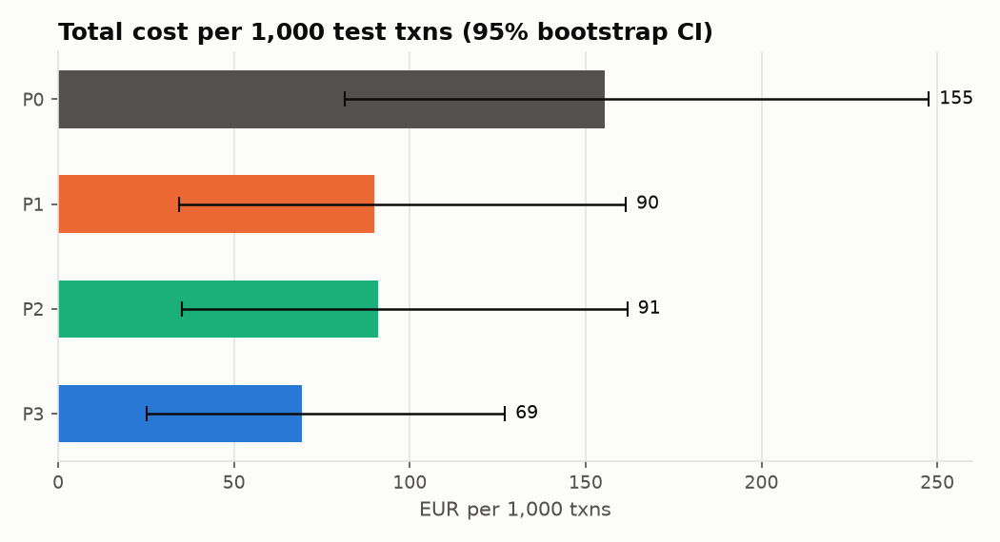
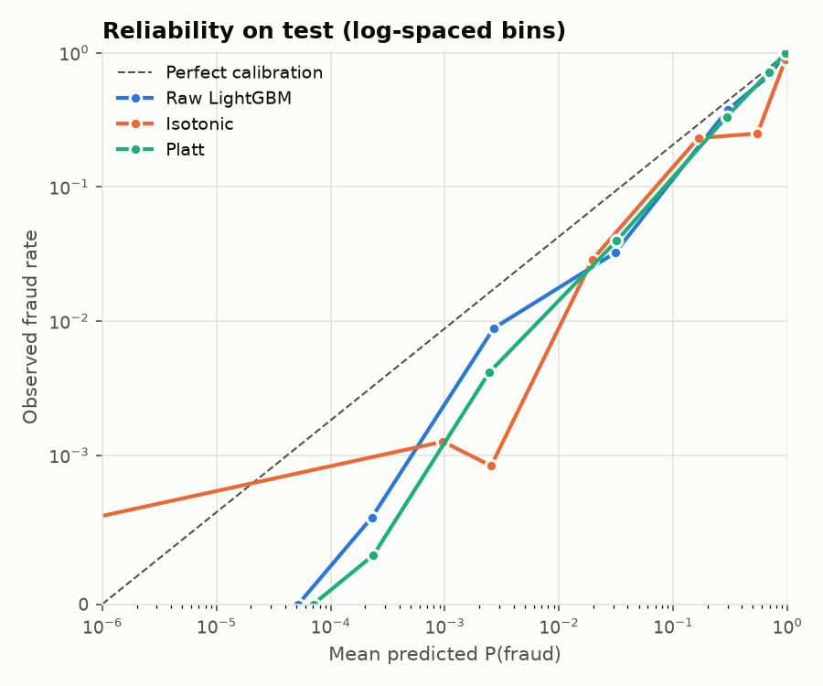
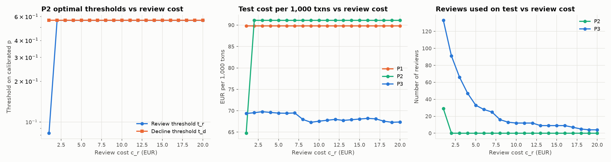
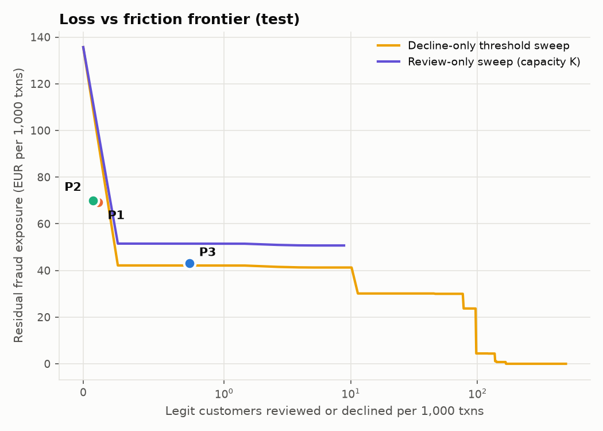

# Transaction Risk Decision Framework

Turning a fraud score into **approve / review / decline** decisions that minimise expected € cost,
and measuring them with business KPIs and bootstrap confidence intervals.

The model is deliberately plain (LightGBM on the ULB credit-card data). The focus is the **decision
layer**: calibrated probabilities, an explicit cost model, policies compared at equal review capacity,
and honest uncertainty given only a few dozen frauds in the test window.

> One-page summary for a Trust & Risk leader: [`reports/decision_memo.md`](reports/decision_memo.md)

## Background and status

**Status: in progress.**

This builds on a small-scale risk evaluation I did as a coursework project at **IIT Madras**:
**Credit Default and Fraud Risk Prediction (American Express – IIT Madras, Nov–Dec 2022)**.

- **Data preparation:** EDA, scaling, KNN imputation for missing values, SMOTE-Tomek to balance
  the classes, and one-hot encoding.
- **Modelling:** stratified K-fold cross-validation with hyperparameter tuning across XGBoost,
  LightGBM, AdaBoost, Random Forest, Logistic Regression, Naïve Bayes and KNN.
- **Result:** XGBoost performed best, with ROC-AUC 70.81% and F1 62.54%.

That work stopped at predicting risk and was judged on model metrics. This project is the next
step: it moves from *predicting* risk to *deciding* on it.

| | IIT Madras project (2022) | This project |
|---|---|---|
| Question answered | "How risky is this case?" | "What should we do about it, and what does it cost?" |
| Class imbalance | Resampled (SMOTE-Tomek) | Kept as is, so probabilities stay true to real fraud rates |
| Output | Class label / score | Calibrated probability → approve / review / decline |
| Validation | Stratified K-fold | Time-ordered split, so the test period comes after training |
| Success measure | ROC-AUC, F1 | € cost per 1,000 txns, fraud € caught, false positives, savings with bootstrap CIs |
| Operational limits | — | Review capacity, review cost, customer friction |

Planned next steps are listed under [Limitations](#limitations).

## Quick start

```bash
pip install -r requirements.txt
kaggle datasets download -d mlg-ulb/creditcardfraud -p data/raw --unzip   # -> data/raw/creditcard.csv
python run_all.py        # ~30 s; writes everything in reports/ and refreshes the results below
python -m pytest -q      # unit tests for cost functions and policies
```

## Data and setup

- **Dataset:** [Kaggle `mlg-ulb/creditcardfraud`](https://www.kaggle.com/datasets/mlg-ulb/creditcardfraud):
  284,807 European card transactions over ~48 hours; 492 frauds (0.17%). Features `V1–V28` are PCA
  components (anonymised), plus `Time` and `Amount`.
- **Split:** ordered by `Time`, 60% train / 20% validation / 20% test, no shuffling. Validation is
  cut in half by time to avoid reusing the same rows for everything:
  - **val_a:** LightGBM early stopping and fitting the calibrators.
  - **val_b:** choosing class weighting (PR-AUC), choosing the calibrator (Brier), grid-searching P2's thresholds.
  - **test:** touched once, for the final evaluation.
- **Features:** `V1–V28`, `Amount`, `hour = (Time // 3600) mod 24`. Raw `Time` is dropped because it
  only encodes position in the split.

## Decision formulation

For transaction *i*:

| Symbol | Meaning | Value (`config/costs.yaml`) |
|---|---|---|
| p_i | calibrated P(fraud) from the model | — |
| A_i | transaction amount (EUR) | — |
| c_r | cost of one manual review | €5 |
| ρ | probability a review catches a transaction that is fraud | 0.90 |
| φ | overhead per approved fraud on top of the amount (chargeback fee, ops) | €15 |
| m | margin lost on a falsely declined legit transaction, as a fraction of A_i | 0.03 |
| κ | fixed cost of a false decline (customer friction, churn risk) | €10 |
| δ | friction cost of reviewing a legit transaction | €1 |
| K | review capacity, as a fraction of transactions in the batch | 1% |

Expected cost of each action:

```
E[C | approve] = p_i (A_i + φ)
E[C | review]  = c_r + p_i (1 − ρ)(A_i + φ) + (1 − p_i) δ
E[C | decline] = (1 − p_i)(m · A_i + κ)
```

**Realised cost** (used for tuning and evaluation) is the same formula with the true label
y_i ∈ {0, 1} in place of p_i. For reviews it is the expectation over the review outcome, so it is
deterministic given the label.

### Policies

| Policy | Rule | Fitted on |
|---|---|---|
| **P0** approve-all | approve everything (baseline) | — |
| **P1** fixed cut-off | decline if p > 0.5, else approve | — |
| **P2** global thresholds | review if t_r < p ≤ t_d, decline if p > t_d; grid search over (t_r ≤ t_d) to minimise realised cost; if the review band exceeds K, the highest-p transactions are reviewed and the rest approved | val_b |
| **P3** per-transaction | argmin of expected cost per transaction; if reviews exceed K, keep those with the largest expected saving of review over the best non-review action, the rest take their best of approve/decline | nothing (uses calibrated p only) |

### KPIs (`reports/kpis.csv`)

| KPI | Definition |
|---|---|
| Fraud € caught rate | (fraud € declined + ρ × fraud € reviewed) / total fraud € |
| Residual exposure | fraud € approved + (1 − ρ) × fraud € reviewed |
| False-positive rate | legit transactions reviewed or declined / all legit |
| Review / decline rate | share of transactions reviewed / declined |
| Cost per 1,000 txns | total realised cost / n × 1,000 |
| ROI per review | [ρ × Σ(A + φ) over reviewed frauds − c_r × #reviews − δ × #legit reviewed] / #reviews: net € value of each review vs approving it |
| Savings vs P1 / vs approve-all | reference policy's total cost − this policy's total cost |

**Uncertainty:** 1,000 bootstrap resamples of the test rows, with decisions held fixed.
Savings use *paired* resamples (the same rows for both policies). 95% percentile intervals are in
`reports/kpis_bootstrap.csv`.

## Assumptions

| Assumption | Why it matters | How to relax it |
|---|---|---|
| Cost parameters are illustrative, not measured | They decide every threshold | Get c_r, φ, κ, m from Finance/Ops; the sensitivity sweep shows how c_r moves the answer |
| A review catches fraud with fixed probability ρ, independent of amount | Overstates review value on hard cases | Estimate ρ by risk band from review outcomes |
| Declines lose a fraction of margin + a fixed friction cost; no long-term churn | Understates the cost of declining good customers | Add customer lifetime value to κ |
| Decisions are independent; capacity is a per-batch fraction | No queueing or time-of-day staffing | Model capacity per hour |
| Labels are final and known | Real chargebacks arrive weeks later | Train on matured labels only |
| Calibrated p is accurate out of time | P3 relies on it directly | Monitor calibration drift; recalibrate regularly |

## Results

All numbers below are generated automatically by `run_all.py` from the saved outputs in `reports/`, so they always match the code.

<!-- RESULTS:START -->
### Data split (time-ordered)

| Split | Rows | Frauds | Fraud rate | Fraud € |
|---|---:|---:|---:|---:|
| train | 170,884 | 360 | 0.211% | €40,168 |
| val_a | 28,480 | 24 | 0.084% | €5,394 |
| val_b | 28,481 | 33 | 0.116% | €6,837 |
| test | 56,962 | 75 | 0.132% | €7,729 |

### Model (test set)

Weighting chosen on val_b PR-AUC: **unweighted** (PR-AUC 0.841 unweighted vs 0.807 with scale_pos_weight). Calibrator chosen on val_b Brier: **platt**.

| Scores | AUC | PR-AUC | Brier |
|---|---:|---:|---:|
| raw | 0.9865 | 0.7895 | 0.000444 |
| isotonic | 0.9591 | 0.7673 | 0.000467 |
| platt (used) | 0.9865 | 0.7895 | 0.000444 |

### Policies on test

Test set: 56,962 txns, 75 frauds, €7,729 fraud amount. Review capacity K = 569 reviews. P2 thresholds fitted on val_b: t_r = 0.562, t_d = 0.562 (equal, so P2 uses **no review band**).

| Policy | Cost / 1k txns [95% CI] | Fraud € caught | Residual exposure | FPR | Review rate | Decline rate | ROI / review | Savings vs P1 [95% CI] | Savings vs approve-all [95% CI] |
|---|---|---:|---:|---:|---:|---:|---:|---|---|
| P0 approve-all | €155.4 [€81.4, €247.6] | 0.0% | €7,729 | 0.000% | 0.000% | 0.000% | — | −€3,737 [−€7,769, −€538] | — |
| P1 decline if p>0.5 | €89.8 [€34.5, €161.4] | 49.0% | €3,941 | 0.011% | 0.000% | 0.102% | — | — | €3,737 [€538, €7,769] |
| P2 global thresholds | €91.1 [€35.1, €161.8] | 48.4% | €3,989 | 0.007% | 0.000% | 0.093% | — | −€72 [−€247, €20] | €3,665 [€491, €7,759] |
| P3 per-txn expected cost | €69.4 [€25.0, €127.0] | 68.2% | €2,455 | 0.076% | 0.058% | 0.118% | €9.42 | €1,162 [−€352, €3,493] | €4,899 [€1,307, €9,362] |

Bootstrap probability that P3 is cheaper than P1: **84.9%**; than approve-all: **99.7%** (1,000 paired resamples).

### Review-cost sensitivity (P2 re-fitted on val_b per c_r; evaluated on test)

- P2 uses a review band only for c_r ≤ €1; above that, its optimal t_r = t_d.
- P3 reviews on test fall from 133 at c_r = €1 to 4 at c_r = €20; P3 cost per 1k stays within €67.3–€69.8.
- Full table: `reports/sensitivity_cr.csv`.
<!-- RESULTS:END -->

## Charts

**Total cost per 1,000 test transactions, with 95% bootstrap CIs**


**Calibration (reliability) on test**


**Sensitivity to review cost c_r**: P2 thresholds, test cost, reviews used


**Loss vs friction frontier**: residual fraud € against legit customers impacted. The two curves
are threshold sweeps traced on test labels in hindsight; the policies are marked where they land
without seeing test labels.


Also in `reports/figures/`: the Amount distribution for fraud vs legit transactions.

## Related work (what's not new here)

The core idea, choosing actions by expected cost, is established. This project applies it.

- C. Elkan, *The Foundations of Cost-Sensitive Learning*, IJCAI 2001: cost-based decision thresholds.
- A. Correa Bahnsen, A. Stojanovic, D. Aouada, B. Ottersten, *Cost Sensitive Credit Card Fraud Detection Using Bayes Minimum Risk*, ICMLA 2013, and the follow-up work on example-dependent cost-sensitive models: per-transaction, amount-dependent fraud costs.
- C. K. Chow, *An Optimum Character Recognition System Using Decision Functions*, IRE Trans. Electronic Computers, 1957; and *On Optimum Recognition Error and Reject Tradeoff*, IEEE Trans. Information Theory, 1970: the reject (here, "review") option, formalised.
- A. Dal Pozzolo, O. Caelen, R. A. Johnson, G. Bontempi, *Calibrating Probability with Undersampling for Unbalanced Classification*, IEEE SSCI 2015: resampling distorts probabilities.
- A. Dal Pozzolo, G. Boracchi, O. Caelen, C. Alippi, G. Bontempi, *Credit Card Fraud Detection: A Realistic Modeling and a Novel Learning Strategy*, IEEE TNNLS 2018: limited investigator capacity.

**What this project adds** is small and practical, not methodological:
- One end-to-end pipeline that combines three actions, amount-dependent costs, a review-capacity limit and an out-of-time test.
- Paired bootstrap intervals on the € savings.
- An out-of-time comparison showing that label-tuned thresholds can underperform when fraud examples are few.

## Limitations

- **Few frauds.** The test window has under 100 frauds, so cost CIs are wide and one large fraud
  can swing a policy's total. Read the bootstrap intervals, not just the point estimates.
- **Threshold tuning is fragile with few labels.** P2's thresholds are tuned on a few dozen
  validation frauds and can land at a poor cut-off. The frontier shows a lower decline threshold
  would have done better on test in hindsight. P3 avoids label-based tuning, which is part of why
  it holds up.
- **Anonymised features.** V1–V28 are PCA components, so there is no domain story in the features
  and no feature engineering.
- **Two days of data.** Fraud rate drifts between the splits (see the split table); there is no
  seasonality, no weekly cycle, and no out-of-period check.
- **No entity-level leakage control.** There are no card or user IDs, so the same card could appear
  in train and test.
- **Cost model is an assumption.** The ranking of policies depends on c_r, ρ, φ, m, κ and δ.

**Next step:** move to IEEE-CIS fraud data with user-level grouping to control leakage, real
merchant/device features, and a longer time window, keeping this decision layer unchanged.

## Layout

```
config/costs.yaml      cost assumptions (single source)
src/data.py            load, time-ordered split, features
src/model.py           LightGBM + isotonic / Platt calibration + metrics
src/costs.py           expected and realised cost functions
src/policies.py        P0–P3, capacity handling, P2 grid search
src/kpis.py            KPI table + paired bootstrap
src/sensitivity.py     c_r sweep, frontier curves
src/plots.py           figures
src/report.py          renders the results above + decision memo from reports/
tests/                 pytest unit tests
run_all.py             one-command pipeline
reports/               all outputs (CSV, JSON, figures, memo)
```

## License

Code: [MIT](LICENSE) © 2026 Saminay786.

Data: not included in this repo. The ULB credit-card dataset is distributed on Kaggle under its own
terms (Database Contents License, DbCL v1.0). Download it yourself with the command in Quick start.
